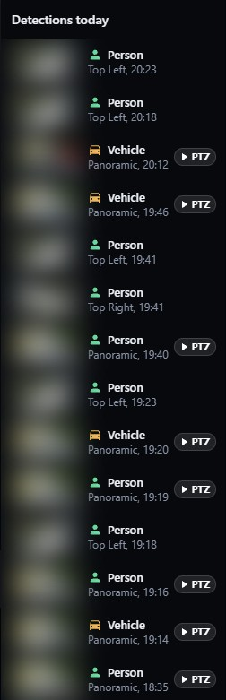
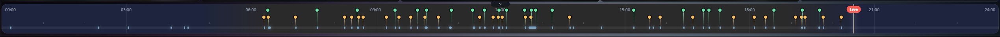

# Ultimate Hikvision NVR card

**Sick of the boring Hikvision layout?** Here's a UniFi Protect style camera wall for your Hikvision recorder, right inside Home Assistant. Live tiles, a big picture, every person and vehicle of the day, and a PTZ you can actually drive.

[](https://hacs.xyz/)
[](https://www.buymeacoffee.com/deekay2153)


- **One big picture, every other camera live beside it.** Tap a tile and it swaps in instantly.
- **Fills any screen,** 3 cameras or 16. Focus, Grid or Single at a tap.
- **Every person and vehicle of the day** on a 24-hour bar and in a list with photos. Tap one to watch it.
- **A PTZ you can drive.** Joystick in any direction, hold to zoom, tap the picture to aim.
- **PERSON / VEHICLE tags** on a camera while it records.
- Works on a PC, an iPad or a phone. Zero setup: one line of YAML.

<p>
  
  &nbsp;
  
</p>



<sub>Camera pictures blurred with the card's screenshot mode (see Good to know).</sub>

## What you need

| | |
|---|---|
| **[Ultimate Hikvision NVR](https://github.com/deekay2153/ultimate-hikvision-nvr)** | The integration (a fork of `hikvision-nvr-ha`). It finds the cameras, plays the recordings and does the person / vehicle search. |
| **[Advanced Camera Card](https://github.com/dermotduffy/advanced-camera-card)** | Plays the live video. |
| A Hikvision NVR with ISAPI | Person / vehicle markers need a recorder with AcuSense (smart search); without it you get the timeline without markers. |

## Install

1. Install the [integration](https://github.com/deekay2153/ultimate-hikvision-nvr)
   and add your recorder (see its README).
2. In HACS, install **Advanced Camera Card** (it is in the default list). It
   plays the live video.
3. HACS → ⋮ → **Custom repositories** → add
   `https://github.com/deekay2153/ultimate-hikvision-nvr-card`, category **Dashboard**,
   then install **Ultimate Hikvision NVR card**.
4. Add the card. That is all it needs:

```yaml
type: custom:ultimate-nvr-card
```

It finds the recorder, its cameras, their Home Assistant camera entities and
motion sensors, and the first PTZ camera by itself. For the camera wall a
panel view (one card, whole page) looks best.

## Options

Everything is optional; anything you set wins over what the card works out.

```yaml
type: custom:ultimate-nvr-card
device: DS-7608NI-…        # which recorder, if you have more than one
channels: [1, 2, 5]        # which cameras, in this order (default: all)
default_mode: live         # or: playback
columns: 5                 # tiles per row (a wall that fills the screen picks 3 to 7 itself)
columns_narrow: 2          # ... on a phone
live_tiles: true           # live video on the small tiles (all: phones too)
fill: true                 # fill the screen on wide screens (false: keep 16:9 rows)
view: focus                # wall layout to start in: focus, grid or single (the header switch remembers your choice)
show_offline: false        # show recorder slots with no camera
go2rtc_url: http://<go2rtc host>:1984   # optional, see below
fast_live:                 # per camera, only what you want to change
  3:
    name: Front Gate
    ring: binary_sensor.gate_ringing   # doorbell rings in the detections list
    buttons:                           # buttons on the big picture
      - { label: Open, icon: mdi:gate, entity: script.open_gate }
ptz:
  channel: 1               # default: the first PTZ camera
  presets:                 # default: the camera's named presets
    - { name: Driveway, icon: mdi:car, preset: 3 }       # a camera preset
    - { name: Night watch, entity: script.night_watch }   # or your own script
  linked: [2]              # default: the PTZ's twin lens (see below); [] for none
```

**Saved views** come from the presets you have *named* in the camera's own web
page. Hikvision PTZs report every slot as in use with a default name, and some
numbers are commands (94 reboots the camera), so unnamed slots and command
numbers are never listed.

**Twin-lens cameras** (a panoramic lens that steers a PTZ, such as TandemVu)
appear as two channels and spot people and vehicles on the panoramic lens only,
so the PTZ's own timeline would stay empty. `ptz.linked` lists the cameras whose
person / vehicle markers the PTZ shows too. It is filled in for you when exactly
one other channel has the PTZ's address; set `linked: []` to turn it off.

**go2rtc:** by default live video goes through Home Assistant's own camera
streaming. If you run go2rtc with one stream per camera, set `go2rtc_url` and a
`stream:` name per camera in `fast_live` (`<name>_main`; tiles use
`<name>_sub`) for faster starts.

## Good to know

- **Slide things away.** Swipe the detections list to the right, or the
  24-hour bar down, for a bigger wall. Swipe back in from the edge, or tap the
  little handle. On an iPad, use the handles: its screen edges belong to iPadOS.
- **Twin-lens cameras** (a panoramic lens that steers a PTZ) are paired
  automatically: the PTZ shows the panoramic lens's people and vehicles, and
  each one gets a ▶ PTZ button to watch the close-up.
- **Screenshot mode:** add `?blur` to the page address and every camera
  picture is blurred, so you can share your wall without sharing your house.
- **History:** day stepper, previous / next event, ±10 s, zoom, and saving a clip.

## Tested on

| Recorder | Cameras | Browsers |
|---|---|---|
| 10-channel Hikvision NVR (AcuSense) | dual-lens PTZ, bullets and turrets (H.265 main, H.264 sub), HiLook turret | Chrome, Edge, Firefox (PC); Safari / HA app (iPhone, iPad) |

That is one install. Other models should work as far as their firmware offers
the same ISAPI features; please open an issue with your model and firmware
either way.

## Known limits

- **Firefox + H.265+ (SmartCodec):** live video freezes after a few seconds.
  Turn H.265+ off for that camera's stream on the recorder (plain H.265 is fine).
- **H.265 in desktop Chrome / Firefox** depends on hardware decoding; the
  sub stream in H.264 is the safe choice for tiles.
- **iPhone / iPad replays** take 10-20 s to start (Home Assistant's HLS route).
- Live tiles are off on phones unless you set `live_tiles: all`.

## Building

`python build.py` joins `src/` into `dist/ultimate-nvr-card.js`.
`preview/index.html` runs the built card against a made-up recorder
(`python -m http.server` in the repo root, then open `/preview/`).

## Support

If this wall makes your cameras nicer to live with, you can [buy me a coffee](https://www.buymeacoffee.com/deekay2153). Thank you!

Found a bug or have an idea? [Open an issue](https://github.com/deekay2153/ultimate-hikvision-nvr-card/issues).

## Licence

MIT. Contains the Hikvision NVR card by
[techmarkai](https://github.com/techmarkai/hikvision-nvr-ha) (MIT) and the
[Arcane PTZ joystick](https://github.com/deekay2153/arcane-ptz-joystick) (MIT).
Not affiliated with or endorsed by Hikvision or Ubiquiti.
