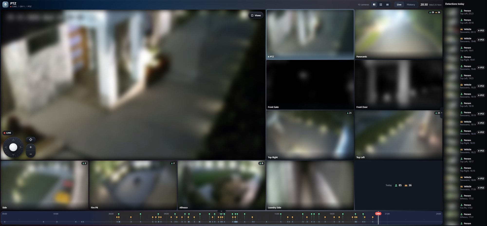
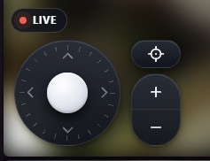

# Ultimate Hikvision NVR card

<p align="center"><br><sub>A real wall, with the camera pictures blurred by the card's own screenshot mode.</sub></p>

**Sick of the boring Hikvision layout and its limits?** This card turns your Hikvision recorder into a modern camera wall inside Home Assistant, with abilities Hik-Connect and iVMS never had. Inspired by UniFi Protect, built for Hikvision. No cloud, no extra app: it talks to your recorder on your own network.

[](https://hacs.xyz/)
[](https://github.com/deekay2153/ultimate-hikvision-nvr-card/releases)

<p align="center"><a href="https://www.buymeacoffee.com/deekay2153"></a></p>

> Not affiliated with or endorsed by Hikvision or Ubiquiti. "Hikvision", "UniFi" and "UniFi Protect" are their trademarks.

## What you get

| | |
|---|---|
| **A live wall that fills the screen** | One big live picture, every other camera as a live tile beside it. Tap a tile and it swaps in instantly. On a tablet or PC it lays itself out to fill the screen whether you have 3 cameras or 18: **Focus**, **Grid** or **Single** at a tap. |
| **Every person and vehicle of the day** | Green for people, amber for vehicles, on a 24-hour bar under the live wall. The detections list down the side shows today's people and vehicles across every camera, each with a photo. Tap one and you're watching that moment. |
| **History that's quick to use** | Play any moment straight from the recorder's disks: day stepper, previous / next event, ±10 s, a zoomable timeline, and saving a clip. |
| **A PTZ you can actually drive** | A joystick that moves in any direction and speed, hold to zoom, **tap the picture to aim the camera there**, and your camera's named presets as saved views. |
| **PERSON / VEHICLE tags** | Pop up on a camera's tile while the recorder is recording something on it. |
| **LIVE and REC badges** | Show what the recorder is really doing. Tap REC to open that recording. |
| **Doorbells and gates** | Point a camera at your doorbell sensor and rings show up in the detections list, with a photo if you save one (see [Doorbell photos](#doorbell-photos)). |
| **Twin-lens cameras** | A panoramic lens that steers a PTZ (TandemVu and the like) is paired automatically: the PTZ shows the panoramic lens's detections, and each one gets a ▶ PTZ button to see what the PTZ lens recorded at that moment. |
| **Phones and tablets** | Portrait and landscape layouts. Swipe the detections list or the 24-hour bar away for a bigger wall. |
| **Screenshot mode** | Add `?blur` to the page address and every camera picture is blurred, so you can share your wall without sharing your house. |

<p align="center">
  
  &nbsp;&nbsp;
  
</p>
<p align="center"></p>

## Requirements

- A **Hikvision NVR** with ISAPI (practically every recent model). Person and vehicle markers need a recorder with **AcuSense** (smart search); without it you still get the wall, History and the timeline, just without markers.
- **[Ultimate Hikvision NVR](https://github.com/deekay2153/ultimate-hikvision-nvr)**, the integration that talks to the recorder (a fork of `hikvision-nvr-ha`).
- **[Advanced Camera Card](https://github.com/dermotduffy/advanced-camera-card)**, which plays the live video.
- Home Assistant 2025.2 or newer. go2rtc is optional (faster starts, see [Options](#options)).

## Install

**HACS (recommended)**

1. Install the [integration](https://github.com/deekay2153/ultimate-hikvision-nvr) and add your recorder (*Settings → Devices & services → Add integration → Hikvision NVR*).
2. In HACS, install **Advanced Camera Card** (it's in the default list).
3. HACS → three-dot menu → *Custom repositories* → add `https://github.com/deekay2153/ultimate-hikvision-nvr-card`, type *Dashboard*.
4. Install **Ultimate Hikvision NVR card**, then reload your browser.

**Manual:** download `ultimate-nvr-card.js` from the [latest release](https://github.com/deekay2153/ultimate-hikvision-nvr-card/releases/latest), put it in `config/www/`, and add `/local/ultimate-nvr-card.js` under *Settings → Dashboards → ⋮ → Resources* as a **JavaScript module**.

## Set up

Add a card with one line:

```yaml
type: custom:ultimate-nvr-card
```

That's all it needs. It finds by itself:

- your recorder and its cameras (cameras that are offline are left off),
- each camera's Home Assistant camera entity and motion sensors,
- the first PTZ camera, its named presets, and its twin lens if it has one.

For the wall, put it on a **panel view** (one card, whole page): *Edit dashboard → add view → View type: Panel*.

## Options

Everything is optional; anything you set wins over what the card works out.

| Option | Default | What it does |
|---|---|---|
| `device` | first recorder | Which recorder, if you have more than one. |
| `channels` | all online | Which cameras, in this order, e.g. `[1, 2, 5]`. |
| `default_mode` | `live` | Open on `live` or `playback` (History). |
| `view` | `focus` | Wall layout to start in: `focus`, `grid` or `single`. The header switch remembers each browser's choice. |
| `fill` | `true` | Fill the screen on wide screens. `false` keeps plain 16:9 rows. |
| `columns` / `columns_narrow` | `5` / `2` | Tiles per row when not filling, and on a phone. (Filling picks 3 to 7 itself.) |
| `live_tiles` | `true` | Live video on the small tiles. Off on phones unless `all`. |
| `show_offline` | `false` | Show recorder slots with no camera. |
| `go2rtc_url` | none | Play go2rtc streams instead of Home Assistant's own streaming (faster starts). |
| `apple_fast_replays` | `false` | iPhone / iPad (iOS 17.1+): play replays from the recorder's fast download, starting in about a second instead of 10-20 s. See [Replays](#replays). |
| `ring_photo_days` | off | Delete doorbell photos older than this many days. See [Doorbell photos](#doorbell-photos). |
| `fast_live` | found for you | Per camera: `name`, `ring`, `ring_label`, `buttons`, `stream`. |
| `ptz` | found for you | `channel`, `presets`, `linked`, `ring_follow`, `joystick`. |

A fuller example:

```yaml
type: custom:ultimate-nvr-card
channels: [1, 2, 3, 4, 5, 6]
view: focus
fast_live:
  3:
    name: Front Gate
    ring: binary_sensor.gate_ringing        # rings in the detections list
    buttons:                                # buttons on the big picture
      - { label: Open, icon: mdi:gate, entity: script.open_gate }
ptz:
  channel: 1
  presets:
    - { name: Driveway, icon: mdi:car, preset: 3 }        # a camera preset
    - { name: Night watch, entity: script.night_watch }    # or your own script
  linked: [2]       # the PTZ's twin lens; [] to turn the pairing off
```

**Saved views** come from the presets you have *named* in the camera's own web page. Hikvision PTZs report every slot as in use with a default name, and some numbers are commands (94 reboots the camera), so unnamed slots and command numbers are never listed.

**go2rtc:** set `go2rtc_url` and a `stream:` name per camera in `fast_live` (`<name>_main`; tiles use `<name>_sub`).

## Using it

- **Swap the big picture:** tap a tile.
- **Full screen:** tap the big picture. In full screen, swipe left / right for the next camera, pinch or scroll to zoom (double-tap resets), and tap to mute or unmute.
- **Aim the PTZ:** tap the aim button, then tap the spot in the picture (or draw a box to zoom in to it).
- **Watch a detection:** tap a dot on the 24-hour bar or a row in the detections list.
- **Slide things away:** swipe the detections list to the right, or the 24-hour bar down. Swipe back in from the edge, or tap the little handle. On an iPad use the handles: its screen edges belong to iPadOS.

## Doorbell photos

Give a doorbell or gate camera a `ring:` sensor and each ring shows in the detections list. To show a photo with it, save one per ring into Home Assistant's media folder as `doorbell/<YYYY-MM-DD>/<camera>_<HHMMSS>.jpg`, where `<camera>` is the camera entity without `camera.`:

```yaml
automation:
  - alias: Doorbell - save a photo of each ring
    triggers:
      - trigger: state
        entity_id: binary_sensor.doorbell_ringing
        to: "on"
    actions:
      - action: camera.snapshot
        target:
          entity_id: camera.front_door
        data:
          filename: >-
            /media/doorbell/{{ now().strftime('%Y-%m-%d') }}/front_door_{{ now().strftime('%H%M%S') }}.jpg
```

**PTZ to the door:** Hikvision intercoms can no longer record themselves. If you have an automation that turns the PTZ to the door and records it when it rings, list those cameras in `ptz.ring_follow` (e.g. `[3, 4]`) and each ring gets a ▶ PTZ button that plays that recording from the ring.

Photos are never deleted unless you ask: with `ring_photo_days: 14`, a wall opened by an admin removes photos older than 14 days, twice a day at most.

## Troubleshooting

| Problem | Fix |
|---|---|
| The big picture stays black | The camera's main stream is probably H.265 and the browser can't decode it. Switch that stream to H.264 on the recorder, or use a browser with hardware H.265 (Safari, Edge). |
| Live video freezes after a few seconds in Firefox | Turn **H.265+ / Smart Codec** off for that stream on the recorder (plain H.265 is fine). |
| No person / vehicle dots | The recorder needs AcuSense (smart search), and the camera's smart events must be switched on in the recorder. |
| The PTZ has no dots but you know it saw people | Twin-lens cameras file detections under the panoramic lens. Check `ptz.linked` points at it. |
| The card doesn't appear after an update | Hard-refresh the browser (Ctrl+Shift+R), or *Settings → Reset frontend cache* in the app. |
| Replays on iPhone / iPad take a while | Turn on `apple_fast_replays: true`. Without it, 10-20 s to start is normal: that's Home Assistant's streaming route. |
| A detection says "No recording of this one" | The recorder saved no video for that moment (check the camera's recording schedule / event triggers on the recorder). "Not on the recorder yet" means it's under 3 minutes old: try again shortly. |

## Replays

Replays come from the recorder's fast download (the same footage the Save
button gets), so they start in about a second and play smoothly even on
cameras with a 2-second keyframe gap.

- **PC (Chrome, Edge, Firefox):** always on.
- **iPhone / iPad:** add `apple_fast_replays: true`. The page fetches the
  download itself and feeds it to Safari's player (ManagedMediaSource, iOS
  17.1+); older iOS keeps the old route. AirPlay is off for replays on this
  route. Replays on Apple devices then carry sound too.
- **Android:** stays on Home Assistant's streaming route for now (not yet
  tested on the fast one).
- If the fast route fails for a moment, the card carries on from the same
  second on the old route by itself.

Tapping a detection on a phone scrolls the page back up to the picture.

## Tested on

| Recorder | Cameras | Browsers |
|---|---|---|
| 10-channel Hikvision NVR (AcuSense) | dual-lens PTZ, bullets and turrets (H.265 main, H.264 sub), HiLook turret | Chrome, Edge, Firefox (PC); Safari / HA app (iPhone, iPad) |

That is one install. Other models should work as far as their firmware offers
the same ISAPI features; please open an issue with your model and firmware
either way.

## Known limits

- **Firefox + H.265+ (SmartCodec):** live video freezes after a few seconds.
  Turn H.265+ off for that camera's stream on the recorder (plain H.265 is fine).
- **H.265 in desktop Chrome / Firefox** depends on hardware decoding; the
  sub stream in H.264 is the safe choice for tiles.

## Building

`python build.py` joins `src/` into `dist/ultimate-nvr-card.js`.
`preview/index.html` runs the built card against a made-up recorder
(`python -m http.server` in the repo root, then open `/preview/`).

## Support

If this wall makes your cameras nicer to live with, a coffee keeps it going. Thank you!

<a href="https://www.buymeacoffee.com/deekay2153"></a>

Found a bug or have an idea? [Open an issue](https://github.com/deekay2153/ultimate-hikvision-nvr-card/issues).

## Licence

MIT. Contains the Hikvision NVR card by
[techmarkai](https://github.com/techmarkai/hikvision-nvr-ha) (MIT) and the
[Arcane PTZ joystick](https://github.com/deekay2153/arcane-ptz-joystick) (MIT).
Not affiliated with or endorsed by Hikvision or Ubiquiti.
